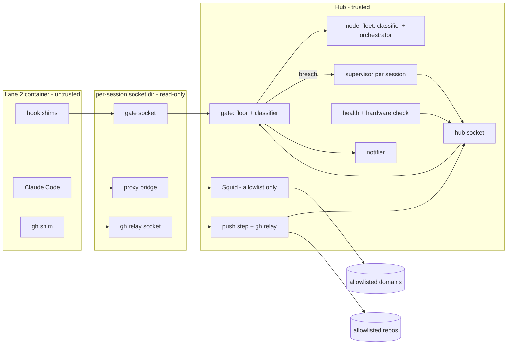

# SP1a — Sensitivity Gate and Local Model Trust Core

> **Status: Planned — design accepted 2026-10-16, not yet implemented.**
> Nothing on this page exists in the repository yet. It describes the agreed
> design. Today's behaviour is in [ORCHESTRATOR.md](ORCHESTRATOR.md) and
> [SAFETY_HARNESS.md](SAFETY_HARNESS.md). Each part of this page will be
> replaced by operator docs as the matching story lands.
>
> Landed so far: the eval set and held-out freeze — [SP1A_EVAL_SET.md](SP1A_EVAL_SET.md).

## Why

**Vision.** A developer stands up a safe, repeatable agent harness on a new
machine and uses it for real work, including sensitive intellectual property.
A local model on a trusted machine (the **hub**) handles sensitive work. Cloud
Claude handles large non-sensitive work. Sensitive material is never placed
where a cloud agent can read it. Everything handed to Claude through a path a
hook can see passes a fail-closed gate. The paths no hook can see are listed
plainly.

**Principles.** A requirement that conflicts with one of these is wrong.

| # | Principle | Meaning |
|---|---|---|
| P1 | Confidentiality boundary, not a way around safety | The gate protects sensitive IP. Sensitive work, and work Claude declines, runs entirely on the local model. Nothing splits or rewords a task so Claude will do what it otherwise would not. |
| P2 | Every layer fails closed on its own | Any error, timeout, crash, malformed answer, or missing policy means block. No layer relies on another to be safe. |
| P3 | Block, never rewrite | Claude-bound content is allowed or blocked. It is never edited in flight. |
| P4 | Outcomes over mechanisms | A hardening measure earns a place only when an outcome needs it. |
| P5 | Separation before inspection | The main control is that sensitive material is absent from the agent's world. The gate is the safety net for what crosses into it. |

## Threat model

**Protected asset.** The operator's sensitive intellectual property: code,
documents, names, plans.

**In scope.** SP1a defends against:

- **Operator slip.** The operator types, pastes, or references sensitive
  content in a Claude session.
- **A well-behaved agent pulls sensitive content into context**, through a
  tool result, a prompt expansion, or a file read.
- **A prompt-injected agent** tries to exfiltrate. Contained by: nothing
  sensitive in the container, minimal container credentials, an egress
  allowlist, git-host writes checked outside the container, no way to change
  host-executed files or its own policy, and the breach response.
- **Container escape as container root.** Mitigated: container root maps to an
  unprivileged host identity that cannot read any hub store, and the container
  has only the mounts it needs.

**Accepted residual risk (until SP1b).**

- **Container content can reach any account on an allowlisted service.** SP1a
  does not inspect outbound request bodies. A domain allowlist cannot tell the
  operator's account from anyone else's. A prompt-injected agent can therefore
  send what is in the container, including the credentials it holds, to any
  account on an allowlisted service, including an attacker's. This is accepted
  only because the container holds nothing sensitive. The allowlist is kept to
  the minimum. SP1b narrows this with full outbound inspection.
- **Container credentials are assumed exposed.** Each one is listed with its
  blast radius. None can read a sensitive repository, the policy repository, or
  any work git host.
- **The gate's answer is observable.** The agent sees allow or block, so a
  confirmed guess can reveal that a term is on the term list. Rate limits and
  probe detection bound this; they cannot remove it.
- **Inference-only sensitivity in a mounted workspace.** Workspace scans use
  the term list only. For content that is sensitive only by inference, the
  operator's decision to mark a workspace mountable is the control.
- **Gate policy at the git host.** The term list and classifier prompt live in
  plaintext in the operator's private policy repository. Their exposure depends
  on that account and that host.
- **Hook-invisible paths.** System prompt, instruction files, skill and agent
  descriptions, git status, IDE context where not disabled, conversation
  summaries, operator-pasted images, and sensitivity that only appears when
  separate blocks combine.
- **Use outside the harness.** Claude in a browser, on another device, or in a
  dev container not started by `lane2 up` is not gated (see the escape hatch).

**Out of scope.** A compromised hub or host OS, including a kernel or
container-runtime exploit to host root. A malicious operator. Compromise of
Anthropic or git-host infrastructure. Supply-chain attacks beyond pinning and
checksum verification.

**Escape hatch.** The operator keeps an unprotected dev container on purpose,
for when SP1a itself is broken. It announces itself as `UNPROTECTED` at start.
It is outside the harness.

## The two lanes

| Lane | Who does the work | Where | Gate |
|---|---|---|---|
| **Lane 1** | The local orchestrator model | On the hub, with sensitive workspaces | Not needed: nothing leaves the hub |
| **Lane 2** | Claude Code | In an untrusted container on the hub, with non-sensitive workspaces only | Every hook-visible item is checked before Claude sees it |

A workspace is sensitive unless the operator marks it mountable. Unmarked
workspaces and all work repositories stay hub-only and never enter a Lane 2
container.

## Components

| Component | Role |
|---|---|
| **Gate** | The only sensitivity decision point. Two independent layers: a deterministic term list (the floor) and a local classifier model. Either one flagging content blocks it. Never rewrites. |
| **Per-session sockets** | Each Lane 2 session gets its own read-only socket directory holding a gate socket, a gh relay socket, and a proxy bridge socket. The gate learns the session from the socket, never from the request. |
| **Hub socket** | A separate gate socket for hub-side callers only (push step, scans, eval, health). Never mounted into a container. |
| **Supervisor (`lane2`)** | One per session. Starts, freezes, stops, and cuts egress for its container. Sole writer of the session registry. |
| **Model fleet** | Two local model services: the orchestrator model (Lane 1) and the classifier (gate). Pinned by version and checksum. Health and context-fit checked before every call. |
| **Squid proxy** | A dedicated instance. HTTPS to allowlisted domains only, then deny all. No DNS, no IP literals, no TLS interception. The container has no other network route. |
| **Push step and gh relay** | All git-host writes leave from the hub. `lane2 push` checks every outgoing object, path, ref, and message, then pushes with a hub-held token. Issue, PR, and comment text goes through the `lane2 gh` relay and the gate. |
| **Hardware check** | Runs on the host. Reports GPU and memory, says pass or below floor, and recommends models. |
| **Health check** | Verifies gate, classifier (a known-sensitive probe blocks, a known-negative probe allows), orchestrator model, proxy, and integration policy. Lane 2 stays blocked while anything fails. |
| **Notifier** | A desktop notification unit for the operator. Shows block categories and refs from the hub logs. Breach notifications are critical and never merged. |

## Gate protocol v1

- **Two socket classes.** Per-session container sockets accept only `prompt`,
  `expansion`, `tool_input`, and `tool_result`. The hub socket accepts `push`,
  `git_text`, `mount_scan`, `rescan`, `eval`, and `health`, and admits only the
  operator and hub service identities. An op sent to the wrong socket is
  blocked.
- **Request.** One JSON header line (`{"v":1,"op":...}`), then the raw payload,
  then half-close. Container requests carry no session, origin, or mode field;
  the gate derives them. Hub requests name the session or workspace, and bulk
  ops pass a hub-produced manifest.
- **Response.** One line: `{"v":1,"verdict":"allow|block","ref":...}`. A ref
  appears only on block. Hub responses may add operator detail; container
  responses never do. One request per connection.
- **Fail-closed callers.** Anything other than a well-formed allow within the
  deadline is a block: empty, malformed, oversized, timeout, missing socket, or
  unknown version. Callers never retry a block into an allow, and never
  truncate or split content.
- **Opaque verdicts.** Inside Claude a block always reads
  `blocked by gate · ref <ref> · see hub notification`. The reason category
  (for example `hit:floor`, `hit:classifier`, `fault:timeout`) goes only to the
  operator's hub log and notification. No payload text is ever logged.

## Breach flow

A classifier or term-list hit on content that came from the container (a file,
a command result, a prompt expansion) proves separation has failed. That is a
**containment breach**. A hit on an operator-typed prompt only blocks that
turn.

1. **Latch.** The gate marks the session latched before it answers. Every later
   request from that session is blocked without evaluation.
2. **Freeze.** The gate signals the supervisor, which freezes the container. If
   the supervisor does not acknowledge in time, the gate stops the session
   unit, which kills the container.
3. **Cut.** The supervisor stops the session's proxy and gate bridges and
   confirms none remain. If it cannot confirm, it kills the container. Then it
   ends the Claude session.
4. **Quarantine.** The workspace is marked quarantined. `lane2 up`, the push
   step, and the gh relay refuse it.
5. **Review.** The operator runs `lane2 review` on the ref, reads the retained
   content on the hub, and records one decision: `remove`, `re-mark sensitive`,
   or `accept risk`. A local model may help; the operator decides. Review offers
   Claude login token rotation for every decision, defaulting to yes on
   `accept risk`. The decision is logged with the ref.

Probing (too many blocks in one session) ends the session the same way, without
quarantine.

## Fallbacks

- **Floor-only session.** When the classifier is unavailable, the operator may
  start `lane2 up --floor-only`. The term list still checks every item, and
  separation, network isolation, and the push step still apply. The session
  shows a banner, raises a notification, and is logged. Hub-side push and mount
  checks also need operator approval at the hub terminal. The mode ends with
  the session. The gate never chooses this mode itself.
- **UNPROTECTED escape hatch.** A separate dev container definition named
  `UNPROTECTED`. Any session not started by `lane2 up` is ungated and prints
  `UNPROTECTED — gate not active` at start. The banner is best-effort. This is
  outside the harness and listed as a residual risk.

## Operator day

1. **Up.** `lane2 up <workspace>`. The supervisor verifies the installed
   integration policy, checks the workspace is marked mountable and not
   quarantined, scans the whole workspace (tree and full git history) with the
   term list, checks gate and classifier health, then starts the container and
   Claude. A paste warning reminds the operator that pasted images are not
   checked.
2. **Work.** Claude works in the container. Blocks show a ref inside Claude; the
   reason appears as a hub notification. Blocked prompts go to the local model,
   or the operator writes a non-sensitive version, which is checked again.
3. **Push.** `lane2 push <workspace>` on the hub. The push step checks
   everything new and pushes to an allowlisted repository. A change to a
   host-executed file needs approval at the hub terminal, with the diff shown.
4. **Review.** After a breach, `lane2 review` as above.
5. **Down.** `lane2 down <workspace>` (or ending the Claude session) stops the supervisor's unit. That removes the
   container and the session's sockets. Nothing auto-starts at boot.
   Quarantine, scan state, and workspace marks persist.

## Decision index

| ID | Decision |
|---|---|
| AD-1 | One gate makes every sensitivity decision; every other component asks it. |
| AD-2 | Gate protocol v1: per-session container sockets, one hub socket, one request per connection. |
| AD-3 | Every caller fails closed on any non-allow answer. |
| AD-4 | Verdicts are opaque to the model; reasons go only to the operator. |
| AD-5 | A hit on container-origin content is a breach: latch, freeze, cut, quarantine, review. |
| AD-6 | The supervisor owns the Lane 2 lifecycle; `lane2 up` is the only gated start. |
| AD-7 | Every hub store has exactly one writer; none lives in the container. |
| AD-8 | All git-host writes leave from the hub through the push step or gh relay. |
| AD-9 | No network except the per-session proxy bridge and the gate socket. |
| AD-10 | Every model call goes through one client contract with health and context-fit checks. |
| AD-11 | Gate mode (`full` or `floor-only`) is declared per session by the operator. |
| AD-12 | The Claude Code integration policy is hub-owned and read-only in the container. |
| AD-13 | One Claude login token, injected per container at start, never stored in it. |
| AD-14 | Hub code lives under `scripts/hub/`, shared libs under `scripts/lib/`, protected from template sync. |
| AD-15 | Host-executed files are mounted read-only into the container. |
| AD-16 | The hub mints the session identity; the container cannot assert it. |
| AD-17 | The gate latches a breached session before answering and signals the supervisor. |
| AD-18 | The hub runs only code installed from a merged commit, never a workspace. |
| AD-19 | A policy version keys the verdict cache; any policy change invalidates it. |
| AD-20 | Each op has a fixed origin, layer set, and deadline; callers never choose them. |
| AD-21 | The container runs with user-namespace remapping, a read-only root, and a fixed mount list. |
| AD-22 | Operations: install, restart, boot, logs, backups, and upgrades follow fixed rules. |
| AD-23 | Claude Code is pinned to an exact version with auto-update off. |
| AD-24 | Workspaces are scanned before mount, while mounted, and after every policy change. |

## Deferred

- Swapping the gate runtime and load testing it (the protocol isolates this).
- SP1b outbound gateway, SP4 local front end and delegation, SP3 remote spokes.
- Spokes (deploy boxes, workstations) in SP3: Claude stays on the hub and drives
  each spoke over hub-initiated SSH through a gated relay the operator confirms.
  Spoke output comes back as untrusted, gated content. No Claude, forwarded SSH
  agent, or reverse tunnel runs on a spoke. Until then, Claude sessions on a
  spoke are outside the harness.
- VS Code attach to a Lane 2 container: refused until proven not to open an
  egress path.
- How client prompt history and persisted tool output are disabled or purged
  on block: verified at build, proven by the end-to-end leak test.
- Tuned values: probe budget, rate limit, acknowledgement timeout, rescan
  interval, bulk-op budgets, request size limit, log retention.
- Hardware floor values and the model recommendation table (need benchmarks).
- Model choices and runtime build (decided by bake-off and the eval selection
  rule).
- Whole-conversation classifier scans, hub transcript retention, backup tool,
  and retiring the legacy routing scripts.
